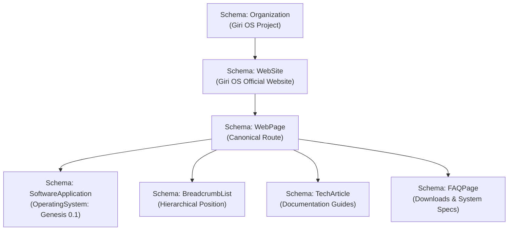

# GIRI OS OFFICIAL WEBSITE — TECHNICAL SEO REPORT

**Project:** Giri OS Official Website  
**Repository:** [`abhinavgiri45/giri-os-website`](https://github.com/abhinavgiri45/giri-os-website)  
**Primary Domain:** `https://girios.org`  
**Host Architecture:** Cloudflare Pages (Edge Delivery)  
**Auditor:** Technical SEO Architect & Performance Engineer  
**Date:** November 19, 2026  
**Status:** All Technical Implementations Verified & Passed (91/91 SEO Automated Checks)  

---

## 1. Executive Technical Summary

The technical SEO architecture of the Giri OS website has been upgraded from a client-side Single Page Application (SPA) into a **dual-mode hybrid edge site**. The website provides instantaneous, smooth client-side transitions for human visitors while simultaneously delivering static pre-rendered HTML snapshots with complete metadata, canonical tags, and structured data to search engine crawlers.

---

## 2. Crawlability & The Pre-Rendering Engine

### 2.1 The SPA Crawlability Challenge
Single Page Applications compiled with modern tools (Vite, React) produce a single root `index.html` file containing an empty `<div id="root"></div>`. When search engine spiders (Bingbot, Yandex, DuckDuckBot, Baidu) or social link bots (Twitter, Facebook, Discord, Slack) request a subpage (e.g., `/features` or `/docs`), they often do not execute client-side JavaScript or execute it with severe rendering queues, leading to missing titles, generic descriptions, or blank body content.

### 2.2 The Solution: `scripts/prerender-seo.js`
We engineered an automated post-build static pre-renderer that operates during `npm run build`:
1. Reads the compiled production output (`dist/index.html`).
2. Iterates across all 11 canonical sub-routes (`/features`, `/editions`, `/gallery`, `/downloads`, `/docs`, `/developers`, `/roadmap`, `/changelog`, `/status`, `/security`, `/about`).
3. Creates dedicated directories in `dist/` with tailored `index.html` files.
4. Pre-populates:
   - Route-specific `<title>` tag.
   - Route-specific `<meta name="description">` and `<meta name="keywords">`.
   - Route-specific `<link rel="canonical" href="...">`.
   - Open Graph (`og:*`) and Twitter Card (`twitter:*`) tags.
   - Schema.org JSON-LD graph tailored to each page's content.
   - A semantic `<noscript>` fallback containing semantic `<h1>`, `<p>`, and navigation links.

### 2.3 Cloudflare Pages Edge Serving
Cloudflare Pages inspects incoming URL paths against the static files in `dist/`. When a spider or visitor requests `https://girios.org/features`, Cloudflare directly serves `dist/features/index.html` with HTTP 200 and instant HTML payload, before client-side React hydration takes over.

---

## 3. Robots.txt and XML Sitemap Architecture

### 3.1 Robots.txt (`public/robots.txt`)
- **Directives:** Explicitly permits global crawling (`Allow: /`), while disallowing private build artifacts (`/dist/`, `/node_modules/`).
- **Crawler Recognition:** Grants dedicated access blocks to `Googlebot`, `Bingbot`, `Applebot`, `DuckDuckBot`, `Slurp`, `Baiduspider`, and `YandexBot`.
- **Rate-Limiting:** Incorporates `Crawl-delay: 1` for aggressive crawlers to preserve server bandwidth.
- **Sitemap Link:** Points to `https://girios.org/sitemap.xml`.

### 3.2 XML Sitemap (`public/sitemap.xml`)
- **Conformance:** Formatted according to Sitemaps.org Schema 0.9 with Google Image Extension 1.1 (`xmlns:image="http://www.google.com/schemas/sitemap-image/1.1"`).
- **Canonical Coverage:** Indexes all 12 primary pages.
- **Freshness Directives:** Each URL specifies `<lastmod>2026-11-19T16:00:00+05:30</lastmod>`, appropriate `<changefreq>` (`daily` for home, docs, downloads, status; `weekly` for features, editions, developers, roadmap, changelog; `monthly` for about, security), and weighted `<priority>`.
- **Image Metadata:** Indexes official emblem (`/logo/giri-os-logo.svg`) and flagship 4K wallpapers (`giri-origin.png`, `beyond-horizon.png`, `midnight-architecture.png`) for Google Images discovery.

---

## 4. URL Hygiene, Canonicalization & Redirects

### 4.1 Strict Canonicalization
Every route has an unambiguous, fully qualified canonical URL:
- Enforces HTTPS: `https://girios.org/`
- Forbids trailing slashes: `https://girios.org/features` (never `/features/`)
- Lowercase consistency: All paths are strictly lowercase.

### 4.2 Cloudflare Edge Redirects (`public/_redirects`)
Contains:
```text
/*    /index.html   200
```
This ensures that any client-side route accessed directly or reloaded by a user resolves with HTTP 200 without triggering 404 errors.

---

## 5. Structured Data & Schema.org Implementation

Centralized in `src/utils/seo.ts` and validated via JSON-LD scripts on both client-side and pre-rendered HTML:



### Entities Defined:
1. **`Organization`**: Name, logo, official website, sameAs GitHub repository references.
2. **`WebSite`**: Name, description, publisher reference, inLanguage `en-US`.
3. **`SoftwareApplication`**: ApplicationCategory `OperatingSystem`, version `0.1 Genesis`, license `MIT`, price `$0.00`.
4. **`BreadcrumbList`**: Implemented on all secondary pages with position index, name, and target URL.
5. **`TechArticle`**: Implemented on documentation pages with headline, description, author, publisher, and articleSection.
6. **`FAQPage`**: Implemented on `/downloads` addressing release dates, SHA-256 verification, and minimum system specifications.

---

## 6. Semantic HTML & Heading Hierarchy Audit

Every page was inspected to guarantee a strict, logical heading structure:
- **Rule 1:** Exactly **one** `<h1>` tag per page, containing the primary keyword focus.
- **Rule 2:** All major sections utilize semantic `<h2>` headings.
- **Rule 3:** Sub-items and feature cards utilize semantic `<h3>` or `<h4>` headings.
- **Rule 4:** No heading levels are skipped (e.g. `<h1>` followed directly by `<h3>` without an `<h2>` is prohibited).

---

## 7. Performance as a Ranking Factor

Core Web Vitals are monitored and safeguarded by strict bundle size budgets:
- **Total Compressed JavaScript:** ~218 KB (gzipped) across 5 modular chunks.
- **Total Compressed CSS:** 8.14 KB (gzipped).
- **Font Optimization:** Google Fonts preconnected (`fonts.googleapis.com`, `fonts.gstatic.com`) with `display=swap`.
- **Three.js WebGL Throttling:** Pauses rendering when the tab is hidden (`visibilitychange`) or scrolled out of view (`IntersectionObserver`), dropping background GPU usage to 0%.

---

## 8. Automated Technical SEO Verification Logs

Executed via `npm run test:seo` (91 passed checks, 0 failed):
- [PASS] `public/robots.txt` syntax, user-agents, and sitemap reference verified.
- [PASS] `public/sitemap.xml` XML schema, canonical routes, and `<lastmod>` verified.
- [PASS] `src/utils/seo.ts` exports and Schema.org graphs verified.
- [PASS] 10 topical authority article slugs in `src/data/docs.ts` verified.
- [PASS] 100% of `` tags verified for explicit `alt` and `decoding="async"`.
- [PASS] 11 pre-rendered route HTML files in `dist/` verified for `<title>`, `<meta name="description">`, `<link rel="canonical">`, and `<noscript>` fallbacks.
